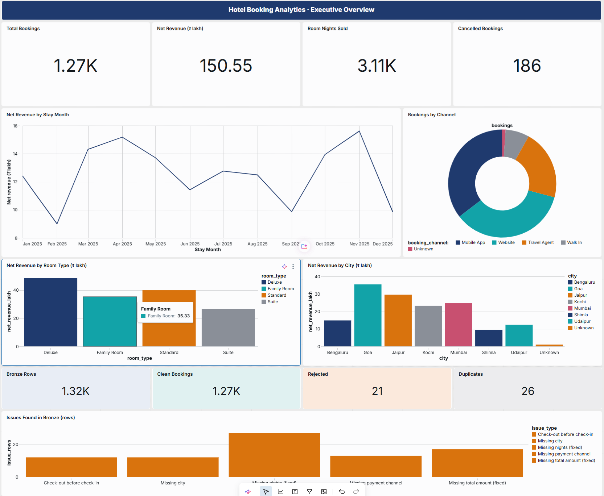
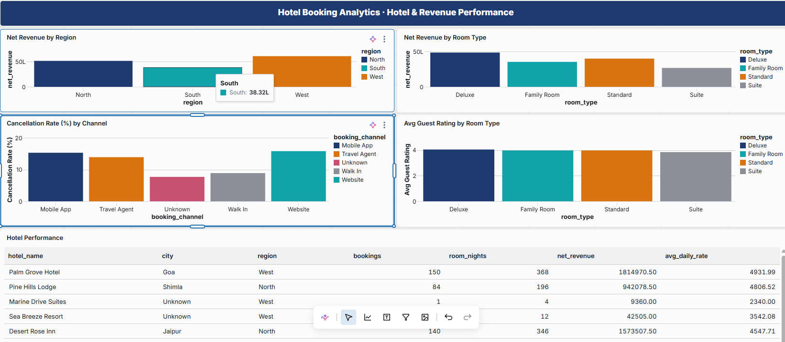
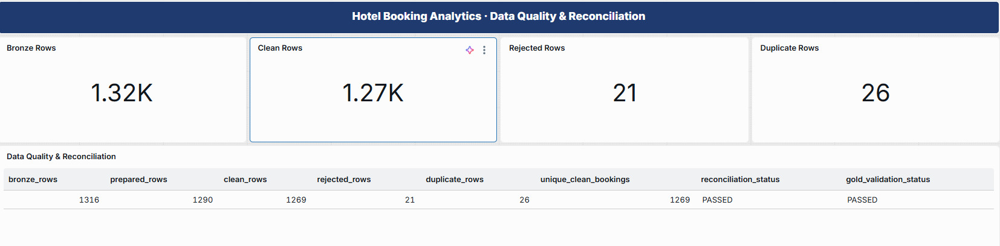

# 🏨 Hotel Booking Analytics Platform
### End-to-End Data Engineering Project Using Databricks, SQL & Lakeflow Spark Declarative Pipelines


## 📌 Project Overview

The **Hotel Booking Analytics Platform** is an end-to-end Data Engineering project developed as part of the **Innomatics Research Labs Data Engineering Internship**.

The project demonstrates how raw hotel booking data can be transformed into reliable, analytics-ready datasets using **Databricks SQL, Unity Catalog, Delta Lake, Lakeflow Spark Declarative Pipelines, and Medallion Architecture**.

The pipeline processes **1,316 synthetic hotel booking records**, addresses data-quality issues, generates business-level analytics, and powers an interactive three-page Databricks AI/BI dashboard.

### Project Objectives

- Implement an end-to-end ETL pipeline using Databricks.
- Apply Bronze, Silver, and Gold Medallion Architecture.
- Identify and handle duplicate, incomplete, and invalid bookings.
- Implement data-quality expectations and rejection handling.
- Generate analytics-ready Gold materialized views.
- Validate data reconciliation across pipeline layers.
- Build an interactive business intelligence dashboard.

---

## 🛠️ Technologies Used

| Technology | Purpose |
|---|---|
| Databricks | Cloud data engineering and analytics platform |
| Apache Spark | Distributed data processing engine |
| Databricks SQL | Data transformation and analytical queries |
| Lakeflow Spark Declarative Pipelines | Declarative ETL pipeline implementation |
| Unity Catalog | Data governance and storage organization |
| Delta Lake | Storage format for managed analytical tables |
| Medallion Architecture | Bronze, Silver and Gold data organization |
| Databricks AI/BI Dashboards | Business intelligence and visualization |
| Genie Code | AI-assisted dashboard development |
| GitHub | Version control and project documentation |

---

## 🏗️ Project Architecture

The project follows Medallion Architecture.

```text
              HOTEL BOOKING DATASET
               hotel_bookings_raw.csv
                        |
                        v
             UNITY CATALOG VOLUME
     hotel_bookings.default.bookings_volume
                        |
                        v
              BRONZE LAYER
           bronze_hotel_bookings
              1,316 Records
                        |
                        v
           SILVER PREPARATION
          silver_bookings_prepared
              1,290 Records
                        |
            +-----------+-----------+
            |                       |
            v                       v
       SILVER CLEAN            SILVER REJECTED
 silver_bookings_clean     silver_bookings_rejected
      1,269 Records              21 Records
            |
            v
              GOLD ANALYTICS
            +-----------------------+
            | gold_monthly_bookings |
            | gold_hotel_summary    |
            | gold_room_type_summary|
            | gold_channel_summary  |
            | gold_data_quality     |
            +-----------------------+
                        |
                        v
             DATABRICKS AI/BI
             3-PAGE DASHBOARD
```

### Medallion Layer Responsibilities

**Bronze Layer — Raw Data Ingestion**

Ingests the original CSV dataset into a streaming table while preserving source records and adding ingestion metadata.

**Silver Layer — Data Cleaning**

Standardizes, deduplicates, validates, and transforms raw records into clean datasets. Invalid bookings are stored in a separate rejected table with rejection reasons.

**Gold Layer — Business Analytics**

Creates aggregated datasets supporting hotel performance, monthly trends, room-type analysis, booking-channel analysis and data-quality reporting.

---

## 📂 Dataset Information

The project uses a synthetic hotel booking dataset for the year **2025**.

| Attribute | Details |
|---|---|
| Dataset | hotel_bookings_raw.csv |
| Total Records | 1,316 |
| Total Columns | 20 |
| Hotels | 10 |
| Cities | 7 |
| Currency | INR (₹) |
| Data Type | Synthetic hotel booking records |

### Important Dataset Columns

- `booking_id`
- `guest_id`
- `booking_date`
- `check_in_date`
- `check_out_date`
- `nights`
- `hotel_name`
- `city`
- `region`
- `room_type`
- `booking_channel`
- `guests`
- `room_rate`
- `total_amount`
- `discount_amount`
- `meal_plan`
- `payment_method`
- `payment_status`
- `booking_status`
- `guest_rating`

### Data Quality Challenges

The dataset contains deliberately introduced problems:

- Duplicate booking IDs.
- Missing city and booking-channel values.
- Inconsistent capitalization and unnecessary spaces.
- Missing nights and total amounts.
- Invalid check-in/check-out dates.
- Negative room rates.
- Missing guest IDs and ratings.

---

## 🥉 Bronze Layer — Data Ingestion

The Bronze layer loads the source CSV from a Unity Catalog Volume using Auto Loader and a Lakeflow streaming table.

**Source path:**

`/Volumes/hotel_bookings/default/bookings_volume/`

**Target table:**

`hotel_bookings.default.bronze_hotel_bookings`

### SQL Implementation

```sql
CREATE OR REFRESH STREAMING TABLE bronze_hotel_bookings
AS
SELECT
    *,
    _metadata.file_name AS source_file,
    current_timestamp() AS loaded_at
FROM STREAM read_files(
    '/Volumes/hotel_bookings/default/bookings_volume/',
    format => 'csv',
    header => true
);
```

### Result

- Successfully ingested 1,316 raw booking records.
- Preserved all original source columns.
- Added `source_file` and `loaded_at` metadata.
- Created the foundation for downstream Silver transformations.

---

## 🥈 Silver Layer — Data Cleaning & Validation

The Silver layer consists of three materialized views.

### 1. silver_bookings_prepared

Performs initial cleaning and transformation:

- Removes duplicate booking IDs using `ROW_NUMBER()`.
- Standardizes text using `TRIM()` and `INITCAP()`.
- Converts string fields using `TRY_CAST()`.
- Replaces missing city and booking-channel values with `Unknown`.
- Calculates missing nights using `DATEDIFF()`.
- Calculates missing booking amounts using nights × room rate.
- Preserves records for further validation.

### 2. silver_bookings_clean

Contains validated bookings.

Two Lakeflow data-quality expectations are implemented:

```sql
CONSTRAINT valid_stay_dates
EXPECT (
    check_in_date IS NOT NULL
    AND check_out_date IS NOT NULL
    AND check_out_date > check_in_date
)
ON VIOLATION DROP ROW
```

```sql
CONSTRAINT valid_room_rate
EXPECT (
    room_rate IS NOT NULL
    AND room_rate >= 0
)
ON VIOLATION DROP ROW
```

These expectations exclude invalid records from the clean dataset.

### 3. silver_bookings_rejected

Stores bookings that fail validation.

Example rejection reasons:

- Invalid stay dates.
- Missing or invalid room rate.
- Negative room rate.

**Important business rule:** Cancelled bookings remain valid business records. They are retained in Silver but excluded from revenue and room-night calculations in Gold.

### Silver Layer Results

| Dataset | Records |
|---|---:|
| Bronze | 1,316 |
| Silver Prepared | 1,290 |
| Silver Clean | 1,269 |
| Silver Rejected | 21 |
| Duplicate Rows Removed | 26 |

---

## 🥇 Gold Layer — Business Analytics

The Gold layer contains five materialized views designed to answer business questions.

### 1. gold_monthly_bookings

Provides monthly booking performance.

Metrics:
- Total bookings.
- Cancelled bookings.
- Completed room nights.
- Net revenue.

**Business question:** How do hotel bookings and revenue change month by month?

### 2. gold_hotel_summary

Analyzes hotel performance by region, city and hotel name.

Metrics:
- Total bookings.
- Completed room nights.
- Net revenue.
- Average Daily Rate (ADR).

**Business question:** Which hotels and cities generate the most revenue?

### 3. gold_room_type_summary

Compares hotel room categories.

Metrics:
- Total bookings.
- Completed room nights.
- Net revenue.
- Average guest rating.

**Business question:** Which room types perform best in terms of revenue and guest satisfaction?

### 4. gold_channel_summary

Analyzes booking channels.

Metrics:
- Total bookings.
- Cancelled bookings.
- Cancellation rate.
- Net revenue.

**Business question:** Which booking channels generate more bookings and have higher cancellation rates?

### 5. gold_data_quality

Provides a consolidated data-quality report.

Metrics:
- Bronze record count.
- Prepared and clean record counts.
- Rejected record count.
- Duplicate record count.
- Missing-value statistics.
- Invalid date and negative-rate counts.
- Reconciliation status.
- Gold validation status.

---

## 📐 Business Metrics & Calculations

### Net Revenue

`Net Revenue = Total Amount − Discount Amount`

Only completed bookings contribute to revenue.

### Room Nights

`Room Nights = SUM(Nights for Completed Bookings)`

### Average Daily Rate (ADR)

`ADR = Net Revenue / Completed Room Nights`

### Cancellation Rate

`Cancellation Rate (%) = (Cancelled Bookings / Total Bookings) × 100`

Cancelled bookings contribute to booking totals and cancellation statistics but do not generate revenue or room nights.

---

## ✅ Data Quality & Reconciliation

A key objective of this project is ensuring that no source records disappear without explanation.

### Reconciliation Formula

**Bronze Records = Clean Records + Rejected Records + Duplicate Records Removed**

```text
Bronze Records       : 1,316
Silver Clean         : 1,269
Silver Rejected      :    21
Duplicates Removed   :    26
--------------------------------
Total Accounted For  : 1,316

Reconciliation Status: PASSED
Gold Validation     : PASSED
Revenue Validation  : PASSED
```

### Validation Performed

- Verified Bronze ingestion count.
- Confirmed duplicate removal.
- Verified clean and rejected record counts.
- Confirmed reconciliation across Bronze and Silver.
- Validated consistency of booking totals across Gold summaries.
- Validated revenue and room-night calculations.
- Confirmed Gold business metrics match Silver source calculations.

**Outcome:** All record-count reconciliation and Gold validation checks passed.

---

## 📊 Databricks AI/BI Dashboard

An interactive three-page Databricks AI/BI Dashboard was created using the Gold analytics datasets, with AI-assisted development using Genie Code.

### Page 1 — Overview

Provides an executive summary of hotel booking performance.

Visualizations include:

- Total Bookings KPI.
- Net Revenue KPI.
- Room Nights KPI.
- Cancelled Bookings KPI.
- Monthly Net Revenue Trend.
- Revenue by City.

**Dashboard Screenshot**



### Page 2 — Hotels, Rooms & Channels

Provides detailed business performance analysis.

Visualizations include:

- Revenue by Hotel.
- Average Daily Rate by Hotel.
- Revenue by Room Type.
- Average Guest Rating by Room Type.
- Cancellation Rate by Booking Channel.
- Channel Performance Summary.

**Dashboard Screenshot**



### Page 3 — Data Quality

Monitors data integrity across the ETL pipeline.

Visualizations include:

- Bronze, Clean, Rejected and Duplicate KPI cards.
- Reconciliation Status.
- Gold Validation Status.
- Data Quality Issues Breakdown.
- Detailed Validation Metrics.

**Dashboard Screenshot**



---

## 📁 Repository Structure

```text
Hotel-Booking-Medallion-Data-Engineering/
│
├── README.md
│
├── sql/
│   ├── 01_bronze_hotel_bookings.sql
│   ├── 02_silver_bookings.sql
│   ├── 03_gold_analytics.sql
│   └── 04_gold_data_quality.sql
│
├── screenshots/
│   ├── Finalpipeline.png
│   ├── Bronze_Table.png
│   ├── SilverBookings_Table.png
│   ├── GoldHotelSummary.png
│   ├── ViewReconciliationStatus.png
│   ├── DashboardOverview.png
│   ├── DashboardHotels.png
│   └── DashboardQuality.png
│
```

---

## 🚀 How to Run the Project

### Prerequisites

- Databricks workspace with Unity Catalog access.
- SQL Warehouse or supported pipeline compute.
- Permissions to create and execute Lakeflow Spark Declarative Pipelines.
- Hotel Booking CSV dataset.

### Step 1 — Prepare Storage

Create the catalog, schema and Volume.

```sql
CREATE CATALOG IF NOT EXISTS hotel_bookings;

CREATE SCHEMA IF NOT EXISTS hotel_bookings.default;

CREATE VOLUME IF NOT EXISTS hotel_bookings.default.bookings_volume;
```

If the catalog, schema or Volume already exists, reuse it.

### Step 2 — Upload the Dataset

Upload `hotel_bookings_raw.csv` to:

`/Volumes/hotel_bookings/default/bookings_volume/`

### Step 3 — Create the Lakeflow Pipeline

Create a pipeline named:

`hotel_booking_medallion_pipeline`

Configure:

- Catalog: `hotel_bookings`
- Schema: `default`
- Language: SQL

### Step 4 — Add the SQL Files

Add the four SQL transformation files from the `sql/` directory.

Ensure only pipeline-supported declarative statements are included in these files.

### Step 5 — Execute the Pipeline

Run the pipeline and verify that the Bronze, Silver and Gold datasets are created successfully.

### Step 6 — Validate Data Quality

Query:

```sql
SELECT *
FROM hotel_bookings.default.gold_data_quality;
```

Verify that both `reconciliation_status` and `gold_validation_status` are `PASSED`.

### Step 7 — Build the AI/BI Dashboard

Create a Databricks AI/BI Dashboard using the five Gold materialized views.

Organize it into three pages:

1. Overview.
2. Hotels, Rooms & Channels.
3. Data Quality.

---

## 🎯 Project Outcomes

The project successfully demonstrates:

- An end-to-end declarative ETL workflow.
- Incremental raw data ingestion using Auto Loader.
- Structured data transformation using SQL.
- Duplicate removal and invalid-record handling.
- Data-quality expectations and reconciliation.
- Analytics-ready Gold materialized views.
- Interactive business intelligence dashboards.
- AI-assisted dashboard development with Genie Code.

### Key Results

| Metric | Result |
|---|---:|
| Input Records | 1,316 |
| Unique Prepared Records | 1,290 |
| Clean Records | 1,269 |
| Rejected Records | 21 |
| Duplicates Removed | 26 |
| Gold Materialized Views | 5 |
| Dashboard Pages | 3 |
| Reconciliation | PASSED |
| Gold Validation | PASSED |

---

## 💡 Key Learnings

Through this project, I gained practical experience in:

1. Designing end-to-end Data Engineering pipelines using Databricks.
2. Understanding Medallion Architecture and the responsibilities of Bronze, Silver and Gold layers.
3. Implementing streaming ingestion and materialized views using Lakeflow Spark Declarative Pipelines.
4. Writing SQL transformations for data cleansing, aggregation and validation.
5. Applying data-quality expectations to handle invalid records.
6. Building meaningful business metrics from operational datasets.
7. Performing reconciliation to ensure data accuracy.
8. Building interactive dashboards using Databricks AI/BI.
9. Using AI-assisted development tools to accelerate analytics and visualization workflows.

This project strengthened my understanding of how raw operational data becomes trusted information for business decision-making.

---

## 🔮 Future Enhancements

Potential improvements include:

- Incremental ingestion of multiple booking files.
- Automated pipeline monitoring and alerting.
- More advanced data-quality checks.
- Booking trends and revenue forecasting.
- Occupancy analysis using hotel room-capacity data.
- Additional dashboard filters and drill-down analytics.
- Automated dashboard refresh scheduling.

These are potential enhancements and are not part of the current completed project scope.

---

## 🙏 Acknowledgement

I would like to thank **Innomatics Research Labs** and the mentors involved in the Data Engineering internship program for providing this hands-on project opportunity.

This project helped me apply concepts from SQL, Databricks, Lakeflow Spark Declarative Pipelines, Medallion Architecture and business intelligence to a practical end-to-end analytics workflow.

---

## 📬 Connect

**GitHub:** https://github.com/suryaprabhag/Hotel-Booking-Medallion-Data-Engineering

**LinkedIn:** https://www.linkedin.com/in/suryaprabha-rebba-6558ba334/

**Project:** Hotel Booking Analytics Platform

**Program:** Innomatics Research Labs — Data Engineering Internship

---

⭐ If you found this project useful, feel free to star the repository.